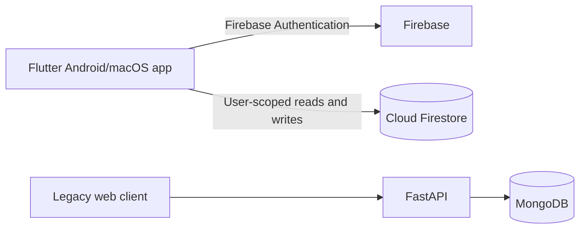

# Beluga Health

## Personal health tracking, medication reminders, and patient records

**Beluga Health** is a student project prototype with a Flutter mobile client and a separate legacy web client. The mobile app uses Firebase Authentication and Cloud Firestore directly; the web client still uses the Python API and MongoDB.

| Client | Availability |
| --- | --- |
| Android | APK releases will be published on [GitHub Releases](https://github.com/Vish-nath/Beluga/releases). No release is available yet. |
| macOS | Flutter macOS target can be built from source on a Mac; a downloadable Mac package is not currently published. |
| Web | Static Firebase Hosting frontend backed by the legacy FastAPI/MongoDB API. |

> **Prototype notice:** Use synthetic data only. This software is not a medical device and does not diagnose conditions, recommend medication, or replace a qualified clinician.

## What Works Today

- **Accounts:** The mobile app registers and signs in with Firebase Authentication email/password. Google sign-in is optional and requires enabling its provider in Firebase Authentication and configuring the mobile OAuth client. Email OTP delivery is not implemented.
- **Personal profile:** View and edit age, gender, blood type, height, weight, location, conditions, appetite, daily routine, family health history, and a profile photo. BMI is calculated from height and weight.
- **Doctor-entered prescriptions:** Save the medicine name, prescribed dose, quantity per intake, clinician instructions, and one or more daily intake times. The app records the instructions provided by the user and does not create or modify prescriptions.
- **Health tracking:** Record steps, active minutes, sleep duration, fasting glucose, and blood pressure.
- **Reminders:** Create meal or routine reminders in the app and get daily local notifications on Android/macOS. Notification actions can mark a medicine as taken or a reminder as done; completion records are saved to the signed-in user's Firestore data.
- **Routine guide:** The dashboard displays general, non-clinical prompts and the user's saved routine/appetite notes. It does not use a medical AI model or generate personalized diet treatment.
- **Patient records:** Keep patient demographics, conditions, allergies, medications, and visit notes, including measurements and follow-up dates.
- **Mobile cloud storage:** The app loads and saves profiles, prescriptions, measurements, reminders, and patient records in Firestore under the signed-in account. Firestore rules restrict each account to its own data.
- **Legacy web storage:** The web client and Python API continue to use MongoDB configured with `MONGODB_URI` and `MONGODB_DATABASE`.

## Planned Product Scope

The following items describe the intended direction and are **not yet available in the app**:

- Clinically reviewed, personalized diet and daily-routine guidance. The current routine guide is a transparent template, not an AI analysis; blood type, gender, and family history are not used to infer diet or treatment.
- Email OTP delivery and account recovery. Google OAuth and email/password are the available sign-in methods.
- A packaged macOS download. The macOS target can be built from source, but no signed Mac installer is published.

## Architecture



The Flutter app restores the Firebase sign-in session and loads its Firestore profile automatically when opened; it does not need a laptop server to be running. Firestore data is separated by Firebase user ID and protected by the deployed `firestore.rules`. The legacy web client still needs its FastAPI/MongoDB backend.

Existing accounts and data in MongoDB are not automatically imported into Firebase. Users need Firebase accounts, and any old data must be migrated separately before it appears in the mobile app.

## Run the Legacy Web API

These server instructions apply to the legacy web client only. The Flutter mobile app does not need this API. From the repository root on Windows PowerShell:

```powershell
py -m venv .venv
.venv\Scripts\Activate.ps1
py -m pip install -r requirements.txt
Copy-Item .env.example .env
notepad .env
py scripts/inspect_and_setup_db.py
py scripts/start_server.py
```

Put your MongoDB connection string in `.env` as `MONGODB_URI`. The database name in the URI is used when present; otherwise the API uses `beluga`. Set `MONGODB_DATABASE` only when you want to override that choice. The tracked `.env.example` contains placeholders only; `.env` is ignored by Git. For MongoDB Atlas, use its connection string and ensure the API server's IP is allowed by the cluster's network access rules. For a local MongoDB server, a URI such as `mongodb://localhost:27017` works. The inspection command verifies the connection and creates the required indexes.

The API is available at `http://<laptop-ip>:8000`. Configure the web client to use its URL ending in `/api` and allow Python through Windows Firewall on private networks if prompted.

Firebase Hosting serves the files in `web/`; it hosts the frontend only, not the FastAPI/MongoDB backend. For a separate API host, set the `beluga-api-base` meta tag in `web/index.html` to the API URL ending in `/api`, and add the web origin to the server's `ALLOWED_ORIGINS` setting.

For Google sign-in in the legacy web client, configure a Google OAuth **Web client ID** in Google Cloud and set it in `GOOGLE_CLIENT_ID` on the laptop server. Mobile Google sign-in instead requires enabling Google in Firebase Authentication and configuring the client ID for the build. On Windows PowerShell, set the web server value before launching it:

```powershell
$env:GOOGLE_CLIENT_ID = "YOUR_WEB_CLIENT_ID.apps.googleusercontent.com"
py scripts/start_server.py
```

Email OTP delivery is not configured; mobile users can use email/password.

## Get the Android APK

Visit [GitHub Releases](https://github.com/Vish-nath/Beluga/releases). **There is no published APK at this time.** Once a tagged build succeeds, download `app-release.apk` from its release entry.

To build locally with Flutter:

```powershell
cd mobile
py bootstrap.py
flutter build apk --release
```

To enable Google sign-in, also pass `--dart-define=GOOGLE_SERVER_CLIENT_ID=YOUR_WEB_CLIENT_ID`. The APK is written to `mobile/build/app/outputs/flutter-apk/app-release.apk`.

### Publish a GitHub release

Before publishing, configure **Settings > Secrets and variables > Actions**:

- `ANDROID_DEBUG_KEYSTORE_BASE64` secret: base64-encoded persistent Android signing keystore. Never commit the keystore or secret.
- `GOOGLE_CLIENT_ID` variable (optional): OAuth client ID used to enable Google sign-in in the APK. Google must also be enabled in Firebase Authentication.

You can publish in either of these ways:

- Push a version tag:

```sh
git tag v1.1.0
git push origin v1.1.0
```

- Or open **Actions > Android APK release > Run workflow**, select the branch to build, enter a version tag such as `v1.1.0`, and run it. The release is created for the selected commit.

After the workflow succeeds, GitHub attaches `app-release.apk` to the release page. A temporary tunnel URL is not suitable for a published build because it can change.

## Build for macOS

An APK only runs on Android. To build the separate macOS app, use a Mac with Flutter and Xcode installed:

```sh
cd mobile
python3 bootstrap.py
flutter build macos --release --dart-define=GOOGLE_SERVER_CLIENT_ID=YOUR_WEB_CLIENT_ID
```

macOS packaging and signing are not part of the current GitHub release workflow.

## Remote Access and Data Safety

The mobile app connects directly to Firebase, so the laptop and API server do not need to be online. Firebase Authentication and Firestore rules scope access to each user's own documents. The legacy web/API still requires its server and database to be reachable.

Firebase users created by the mobile app cannot view other users' data, and there is no mobile administrator view. This prototype still needs an independent security and privacy review, account recovery, abuse protection, encrypted backups, and operational monitoring before real health data or public users are appropriate.
